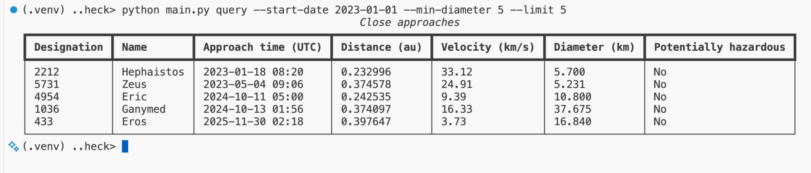

# Asteroid Approach Explorer

A Python command-line application for exploring near-Earth objects and their close approaches to Earth using bundled NASA/JPL datasets.

Look up an asteroid or comet, combine filters to investigate close approaches, and export matching results for further analysis.

## Features

- Look up objects by name or designation, ignoring case and surrounding spaces.
- Combine date, distance, velocity, diameter and potentially hazardous status filters.
- View results in Rich terminal tables, with a plain-text fallback.
- Export results to CSV or write JSON incrementally.
- Explore multiple queries in an interactive shell.
- Receive clear errors for invalid filters, malformed input and failed exports.



## Engineering highlights

| Python technique | Application and purpose |
| --- | --- |
| Inheritance and method overriding | Five concrete filters extend `AttributeFilter` and override `get()`, reusing comparison logic across different attributes. |
| Class methods | Filter subclasses use `@classmethod` for attribute-selection behaviour that does not depend on filter instance state. |
| Properties | Models expose derived names and formatted timestamps through `@property`, including `fullname` and `time_str`. |
| Special methods | Models implement `__str__` and `__repr__`; filters use the scaffold’s `__call__` interface to act as callable predicates. |
| Functions as values | Comparators such as `operator.le` and `operator.ge` are passed into filters, separating comparison behaviour from attribute selection. |
| Generators and lazy iteration | Queries use `yield`; `itertools.islice` limits consumption of matching results. |
| Generic types and explicit interfaces | `limit[T]` preserves element types, while annotations describe callables, iterables and optional NEO relationships. |
| Comprehensions and dictionary indexing | Normalised lookup dictionaries support object searches, while `all()` combines filtering predicates. |
| Context managers and decorators | File operations use `with`; an export-test helper uses `@contextlib.contextmanager` to manage in-memory buffer lifetime. |
| Exception handling | CLI boundaries translate expected input and file failures into useful messages and preserve interactive sessions. |

Some patterns originate in the supplied scaffold. My work implements the core application within that structure and extends its behaviour, testing and automation.

## My contribution

I implemented the NEO models, CSV/JSON extraction, database construction and linking, object lookups, close-approach queries, concrete filters, result limiting and exports.

I then added:

- A separate seven-column Rich renderer with units, readable unknown values and a plain-text fallback.
- Finite, non-negative physical-bound validation and non-negative integer limits.
- Reversed-range checks at the CLI boundary, preserving the supplied query API behaviour.
- Friendly handling of unreadable files, malformed CSV/JSON, unsupported export extensions and failed writes.
- Case-insensitive lookups that trim surrounding whitespace while preserving original model values.
- Incremental JSON export that preserves the existing array and nested NEO structure.
- Project-wide type annotations, focused enhancement tests, development automation and repository security controls.

### Testing contribution

Expanded the automated suite from **73 supplied tests to 102 tests**, adding **29 tests**:

| Area | Added tests |
| --- | ---: |
| CLI value, range and export-extension validation | 23 |
| Rich terminal presentation | 3 |
| Case-insensitive lookups and surrounding whitespace | 2 |
| Empty-stream JSON export | 1 |

The supplied unittest regression tests run alongside the added pytest tests. Their assertions were preserved while annotations and supporting test utilities were improved.

Testing techniques include pytest fixtures, temporary paths, captured terminal output, expected-exception checks and scoped mocking of file operations. The export-test buffer helper was reworked using a scoped mock while retaining its in-memory testing approach.

### Verification evidence

For the v1.0.0 release:

- The full suite passed **102 tests**, with **87% configured core coverage**.
- Project-wide mypy checks passed across **20 source files**.
- Local quality checks, GitHub CI and CodeQL checks passed.
- Manual verification covered direct and interactive commands, invalid values and ranges, malformed input, export failures and forgiving lookups.
- The documented installation and first query succeeded in a fresh checkout with an isolated virtual environment.

Coverage measures the database, extraction, filters, models and export modules. Supplied export tests verify output compatibility alongside the added empty-stream JSON test; incremental consumption was checked through source inspection.

## Quick start

Requires Git and Python 3.12 or newer. These commands use Bash on Ubuntu.

```bash
git clone https://github.com/Victor-GB/asteroid-approach-explorer.git
cd asteroid-approach-explorer
python3 -m venv .venv
source .venv/bin/activate
python -m pip install -r requirements-rich.txt
python main.py query --limit 5
```

The query displays five close approaches in a terminal table. The bundled datasets are included; no separate download is needed.

Rich provides the table presentation. To use the application with only the Python standard library, skip the dependency installation step; query results use plain-text output instead.

## Usage examples

Run these commands from the project directory with the virtual environment active:

```bash
# Inspect Halley's Comet.
python main.py inspect --name Halley

# Find potentially hazardous approaches within 0.05 au during 2020.
python main.py query --start-date 2020-01-01 --end-date 2020-12-31 --max-distance 0.05 --hazardous --limit 5

# Export five approaches in either supported format.
python main.py query --limit 5 --outfile approaches.csv
python main.py query --limit 5 --outfile approaches.json
```

Name and designation lookups ignore case and surrounding spaces. Distances use astronomical units (au), velocities use kilometres per second, and diameters use kilometres.

Terminal queries default to ten results. Exports include all matches unless a limit is supplied. A limit of zero means unlimited results.

Physical bounds must be finite and non-negative. Date and numeric ranges allow equal or omitted bounds; reversed ranges are rejected by the CLI.

### Interactive mode

Start the shell from your Ubuntu terminal:

```bash
python main.py interactive
```

At the application's `(neo)` prompt, enter commands without the `python main.py` prefix:

```text
inspect --pdes 1P
query --date 2020-01-01 --limit 3
exit
```

The datasets are loaded once when the interactive session starts. Invalid query arguments and export failures produce an error message and return control to the prompt.

## Architecture

| Module | Responsibility |
| --- | --- |
| `main.py` | Argument parsing, CLI validation, command dispatch and interactive shell. |
| `models.py` | NEO and close-approach objects, including serialisation. |
| `extract.py` | Read CSV/JSON input, validate its structure and construct model objects. |
| `database.py` | Link objects to their approaches, index lookups and generate matching results. |
| `filters.py` | Compose filtering predicates and limit result streams. |
| `display.py` | Render close approaches as Rich terminal tables. |
| `write.py` | Export results to CSV or JSON. |

Datasets are loaded and linked in memory. Queries generate matching approaches incrementally, and limits are applied before rendering or export. Exports bypass terminal rendering.

JSON export writes one entry at a time, avoiding an additional list containing the entire export. It preserves the JSON array structure and nested NEO objects. This improves export memory usage while retaining the in-memory database design.

## Development and CI

With the virtual environment active, install the development and presentation dependencies:

```bash
python -m pip install -r requirements-dev.txt -r requirements-rich.txt
```

Run the complete quality checks:

```bash
bash scripts/check.sh
```

The shared script runs:

- Ruff formatting, lint and import-order checks.
- Project-wide mypy type checking.
- Dependency vulnerability auditing for development and Rich requirements.
- The complete pytest suite, including the supplied unittest tests, with branch-coverage reporting.

GitHub Actions runs these checks for pushes to `main` and pull requests targeting `main`. The workflow uses Python 3.12 and can also be started manually.

Annotations describe filters as callable predicates, result limiting as a generic operation over iterables, and unlinked NEO relationships as optional. The supplied helper module retains its explicit mypy exception. The helper and original regression-test files retain their configured Ruff exclusions.

### Git hooks

Install the commit and push hooks:

```bash
pre-commit install --hook-type pre-commit --hook-type pre-push
```

Commit hooks perform focused checks, including whitespace, merge-conflict markers and private-key detection. The pre-push hook runs the complete quality-check script.

### Optional development shortcuts

In Bash on Ubuntu, load the portable shortcuts and display their reference:

```bash
source scripts/dev-shortcuts.sh
al
```

Useful shortcuts include `frmpyal` for formatting, lint and project-wide typing, and `ptal` for the complete test suite. Their logs are saved under `tmp/`.

## Repository security

- **Dependabot:** vulnerability alerts and security-update PRs are enabled. The repository configuration schedules weekly version updates for Python dependencies and GitHub Actions.
- **CodeQL:** GitHub-managed default setup analyses Python and GitHub Actions using the default query suite on standard GitHub-hosted runners.
- **Secret scanning:** detects supported credentials committed to the repository.
- **Push protection:** blocks pushes containing supported secrets.
- **Dependency auditing:** local and CI quality checks audit both development and Rich dependencies with `pip-audit`.

Development and presentation dependencies are pinned. Dependency-update PRs are reviewed and checked before merging.

These repository settings complement the quality and security controls stored in Git.

## Provenance and data conventions

This project builds on Udacity’s Exploring Near-Earth Objects project. Udacity supplied the scaffold, command-line and interactive framework, base filter scaffold, helper utilities, datasets and regression tests. My implementation and subsequent enhancements are described above.

The bundled datasets originate from NASA/JPL. The application reads dataset snapshots; it does not retrieve live NASA/JPL updates.

Unknown diameters are displayed as “Unknown” in Rich tables and preserved as `NaN` in JSON exports for compatibility with the original project requirements. CSV fields and the JSON array with nested NEO objects retain the supplied export structure.

The [original project brief](UDACITY_PROJECT.md) is preserved for reference.
