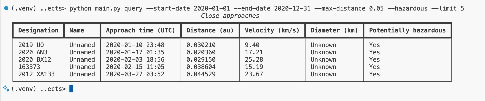

# Asteroid Approach Explorer

A Python command-line application for exploring near-Earth objects and their close approaches to Earth using bundled NASA/JPL datasets.

Look up an asteroid or comet, combine filters to investigate close approaches, and export matching results for further analysis.

## Quick start

Requires Git and Python 3.12 or newer. These commands use Bash on Ubuntu.

```bash
git clone https://github.com/Victor-GB/asteroid-approach-explorer.git
cd asteroid-approach-explorer
python3 -m venv .venv
source .venv/bin/activate
python -m pip install -r requirements-rich.txt
python main.py query --limit 5
```

The query displays five close approaches in a terminal table. The bundled datasets are included; no separate download is needed.

Rich provides the table presentation. To use the application with only the Python standard library, skip the dependency installation step; query results use plain-text output instead.

## Features

- Look up objects by name or designation, ignoring case and surrounding spaces.
- Combine date, distance, velocity, diameter and potentially hazardous status filters.
- View results in Rich terminal tables, with a plain-text fallback.
- Export results to CSV or write JSON incrementally.
- Explore multiple queries in an interactive shell.
- Receive clear errors for invalid filters, malformed input and failed exports.



## Usage examples

Run these commands from the project directory with the virtual environment active:

```bash
# Inspect Halley's Comet.
python main.py inspect --name Halley

# Find potentially hazardous approaches within 0.05 au during 2020.
python main.py query --start-date 2020-01-01 --end-date 2020-12-31 --max-distance 0.05 --hazardous --limit 5

# Export five approaches in either supported format.
python main.py query --limit 5 --outfile approaches.csv
python main.py query --limit 5 --outfile approaches.json
```

Name and designation lookups ignore case and surrounding spaces. Distances use astronomical units (au), velocities use kilometres per second, and diameters use kilometres.

Terminal queries default to ten results. Exports include all matches unless a limit is supplied. A limit of zero means unlimited results.

### Interactive mode

Start the shell from your Ubuntu terminal:

```bash
python main.py interactive
```

At the application's `(neo)` prompt, enter commands without the `python main.py` prefix:

```text
inspect --pdes 1P
query --date 2020-01-01 --limit 3
exit
```

The datasets are loaded once when the interactive session starts.

## Architecture

| Module | Responsibility |
|---|---|
| `main.py` | Argument parsing, CLI validation, command dispatch and interactive shell. |
| `models.py` | NEO and close-approach objects, including serialisation. |
| `extract.py` | Read CSV/JSON input, validate its structure and construct model objects. |
| `database.py` | Link objects to their approaches, index lookups and generate matching results. |
| `filters.py` | Compose filtering predicates and limit result streams. |
| `display.py` | Render close approaches as Rich terminal tables. |
| `write.py` | Export results to CSV or JSON. |

Datasets are loaded and linked in memory. Queries generate matching approaches incrementally, and limits are applied before rendering or export.

JSON export writes one entry at a time, avoiding an additional list containing the entire export. It preserves the JSON array structure and nested NEO objects. This improves export memory usage while retaining the in-memory database design.


## My contribution

I implemented the core models, data extraction, database linking, lookups, filtering, result limiting and exports within the supplied scaffold.

I then added Rich terminal tables, CLI validation and friendly errors, forgiving lookups, streaming JSON export, focused regression tests and project-wide quality checks with GitHub CI.

See [Implementation and portfolio enhancements](EXTENSIONS.md) for the implementation details, repository security controls and verification evidence.

## Development

With the virtual environment active, install the development and presentation dependencies:

```bash
python -m pip install -r requirements-dev.txt -r requirements-rich.txt
```

Run the complete quality checks:

```bash
bash scripts/check.sh
```

This checks formatting, lint, project-wide typing, dependency vulnerabilities and the complete pytest suite, including the supplied unittest tests. Coverage reporting measures the database, extraction, filters, models and export modules.

### Git hooks

Install the commit and push hooks:

```bash
pre-commit install --hook-type pre-commit --hook-type pre-push
```

Commit hooks perform focused checks. The pre-push hook runs the complete quality-check script.

### Optional development shortcuts

In Bash on Ubuntu, load the shortcuts and display their reference:

```bash
source scripts/dev-shortcuts.sh
al
```

Useful shortcuts include `frmpyal` for formatting, lint and project-wide typing, and `ptal` for the complete test suite. Their logs are saved under `tmp/`.

## Repository security

- **Dependabot:** vulnerability alerts and security-update PRs are enabled. Weekly version updates cover Python dependencies and GitHub Actions.
- **CodeQL:** GitHub-managed default setup analyses Python and GitHub Actions using the default query suite on standard GitHub-hosted runners.
- **Secret scanning:** detects supported credentials committed to the repository.
- **Push protection:** blocks pushes containing supported secrets.
- **Dependency auditing:** local and CI quality checks audit both development and Rich dependencies with `pip-audit`.

Dependency-update PRs are reviewed and checked before merging. Commit hooks also include private-key detection.

## Provenance

This project builds on Udacity’s Exploring Near-Earth Objects scaffold and supplied regression tests. I implemented the core application tasks and added the portfolio enhancements described above. The bundled datasets originate from NASA/JPL.

The application reads bundled dataset snapshots; it does not retrieve live NASA/JPL updates. Unknown diameters are displayed as “Unknown” in Rich tables and preserved as `NaN` in JSON exports for compatibility with the original project requirements.

The [original project brief](UDACITY_PROJECT.md) is preserved for reference.
